# Índice

1. [Requisitos y acceso](#requisitos-y-acceso)
2. [Tareas comunes a todos los roles](#tareas-comunes-a-todos-los-roles) (G1 a G4)
3. [Vecino (rol CIUDADANO)](#vecino-rol-ciudadano) (C1 a C10)
4. [Inspector (rol INSPECTOR)](#inspector-rol-inspector) (I1 a I16)
5. [Administrador (rol ADMINISTRADOR)](#administrador-rol-administrador) (A1 a A18)
6. [Auditor (rol AUDITOR)](#auditor-rol-auditor) (U1 a U3)
7. [Qué hace cada rol (resumen)](#qué-hace-cada-rol-resumen)
8. [Mensajes de error y qué significan](#mensajes-de-error-y-qué-significan)
9. [Funciones disponibles solo vía API](#funciones-disponibles-solo-vía-api)
10. [Glosario](#glosario)
11. [Preguntas frecuentes](#preguntas-frecuentes)

Cada tarea tiene un código (por ejemplo **I4**) para encontrarla rápido. Todas siguen el mismo formato: **objetivo**,
**pasos** (con el texto exacto de cada botón en **negrita**), **resultado esperado** y **errores frecuentes**.

> Las capturas se tomaron con datos de prueba ficticios (patentes como AB123CD, DNI 30777888, calles de ejemplo).
> Las fechas y los números que veas en tu pantalla van a ser otros.

# Requisitos y acceso

**Qué necesitás**

- Una computadora, tablet o celular con un navegador actualizado (Chrome, Edge, Firefox o Safari).
- Conexión a internet.
- Un usuario y una contraseña. **Las credenciales las entrega el equipo del Módulo 7**; este manual no las incluye.

**Dirección de la aplicación:** <https://transito-frontend-prod.up.railway.app>

**Los dos espacios de la aplicación**

| Espacio | Para quién | Qué se hace |
|---|---|---|
| **Portal vecino** | Vecinos (rol CIUDADANO). El personal también puede mirarlo. | Consultar infracciones propias, presentar descargos, ver estacionamiento medido, cortes de calle, vehículos retenidos y accidentes. |
| **Panel interno** | Personal municipal: Inspector, Administrador y Auditor. | Registrar y resolver infracciones, cortes, operativos, accidentes, vehículos retenidos y estacionamiento. |

En el **Panel interno** el menú de la izquierda tiene siempre las mismas secciones: **Dashboard**, **Infracciones**,
**Cortes de calle**, **Operativos**, **Accidentes**, **Vehículos retenidos** y **Estacionamiento medido**. Lo que cambia
según el rol son los botones que aparecen dentro de cada sección. En celulares el menú se reemplaza por una lista
desplegable "Sección del panel interno" arriba de la pantalla.

# Tareas comunes a todos los roles

## G1. Ingresar a la aplicación

**Objetivo:** iniciar sesión con tu usuario.

1. Abrí <https://transito-frontend-prod.up.railway.app>.
2. Elegí tu perfil arriba del formulario: **Vecino** (si sos ciudadano) o **Personal municipal** (inspector, administrador o auditor).
3. Escribí tu usuario en **Email o usuario** y tu clave en **Contraseña**.
4. Tocá **Ingresar**.

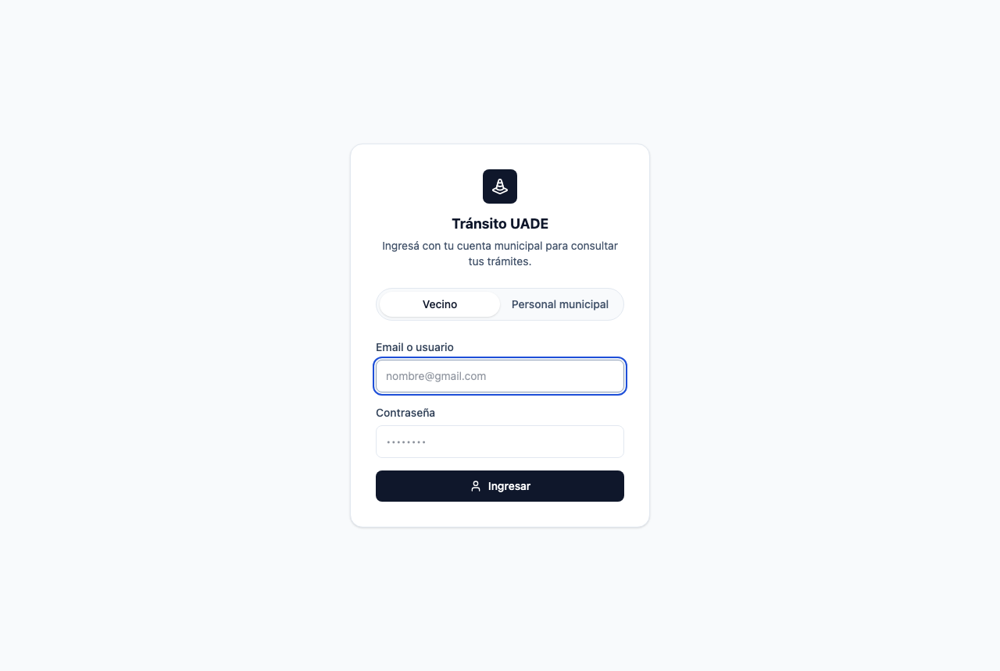

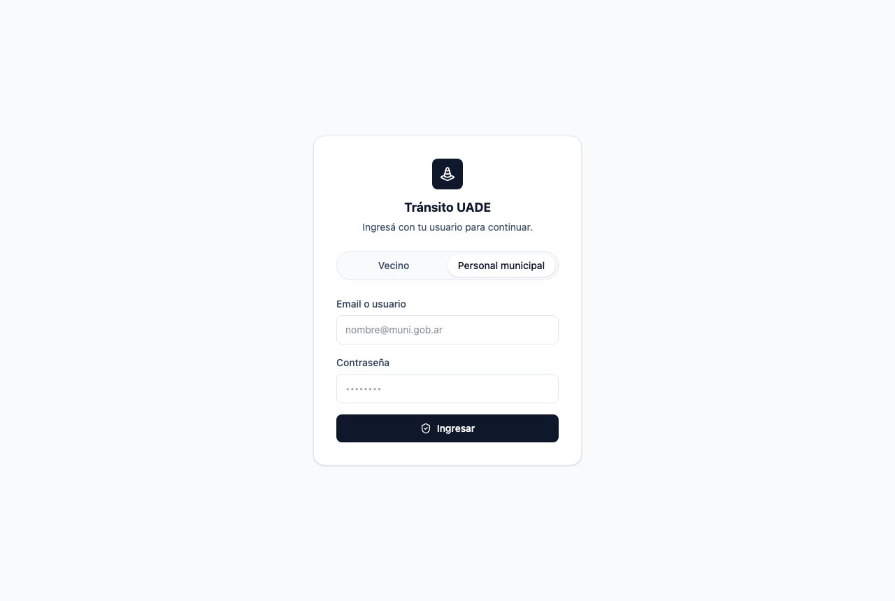

**Resultado esperado:** arriba a la derecha aparece tu usuario y tu rol (por ejemplo "inspector1 · Inspector").
El vecino entra al **Portal vecino**; el personal entra al **Panel interno**, en el **Dashboard**.

**Errores frecuentes**

- *"Usuario o contraseña incorrectos."*: el usuario o la clave están mal escritos. Revisá mayúsculas y espacios.
- *"Demasiados intentos de inicio de sesión. Reintentá en N segundos."* (error 429): hubo muchos intentos fallidos
  seguidos. Esperá los segundos que indica y volvé a probar.
- *"No se pudo conectar con el servidor. Intentá nuevamente."*: no hay conexión o el servidor no responde. Revisá tu internet y reintentá.

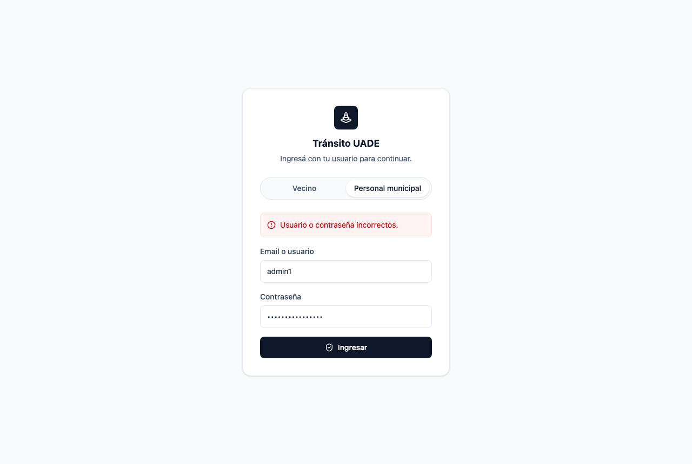

> El perfil elegido (Vecino o Personal municipal) solo cambia los textos del formulario: el rol lo define el sistema
> según tu usuario.

## G2. Salir de la aplicación

1. Tocá **Salir**, arriba a la derecha.

**Resultado esperado:** volvés a la pantalla de ingreso. Si usás una computadora compartida, hacelo siempre al terminar.

## G3. Cambiar entre Portal vecino y Panel interno (solo personal)

1. Arriba, en el centro, tocá **Portal vecino** o **Panel interno**.
2. También podés tocar el logo **Tránsito UADE** para ir al Portal vecino.

**Resultado esperado:** se muestra el espacio elegido. En el Portal vecino, las consultas personales (vehículos y
accidentes propios) muestran el aviso *"Esta consulta está disponible para vecinos que ingresan con su cuenta de
ciudadano."*, porque son solo para vecinos.

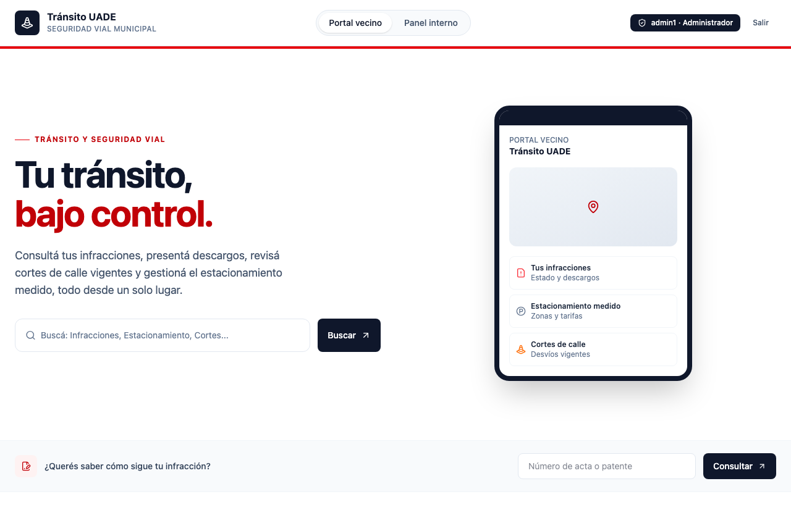

## G4. Qué hacer si la sesión vence

La sesión dura un tiempo limitado. Cuando vence, la aplicación vuelve sola a la pantalla de ingreso con el aviso
*"Tu sesión venció. Volvé a ingresar."* (error 401). Ingresá de nuevo (tarea G1). Si estabas completando un
formulario, vas a tener que cargarlo otra vez.

# Vecino (rol CIUDADANO)

El vecino usa solo el **Portal vecino**. La pantalla de inicio tiene un buscador, una consulta rápida de actas y seis
tarjetas ("Áreas de gestión"). Cada tarjeta muestra abajo un contador (por ejemplo "3 registradas").

## C1. Recorrer el inicio del Portal vecino

**Objetivo:** ubicar cada trámite.

1. Ingresá como vecino (G1).
2. Bajá hasta **¿Sobre qué necesitás hacer una gestión?** y tocá la tarjeta que necesites: **Mis infracciones**,
   **Presentar descargo**, **Estacionamiento medido**, **Cortes de calle**, **Vehículos retenidos** o **Accidentes y denuncias**.
3. Para volver, tocá **Volver al inicio** (arriba a la izquierda de cada pantalla). También podés usar los enlaces del pie
   de página (columna **Trámites**).

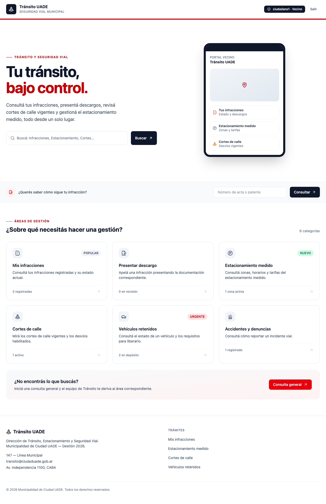

**Resultado esperado:** se abre la pantalla del trámite elegido.

**Para tener en cuenta:** el buscador de arriba (**Buscar**) te lleva siempre a **Mis infracciones**. El botón
**Consulta general** te lleva a **Accidentes y denuncias**, donde se explica cómo contactar a la Línea 147.

## C2. Consultar rápido el estado de un acta

**Objetivo:** saber en qué estado está una infracción sin abrir la lista.

1. En el inicio, buscá la franja **¿Querés saber cómo sigue tu infracción?**
2. Escribí el **número de acta** (completo o sus primeros caracteres) o la **patente** en **Número de acta o patente**.
3. Tocá **Consultar**.

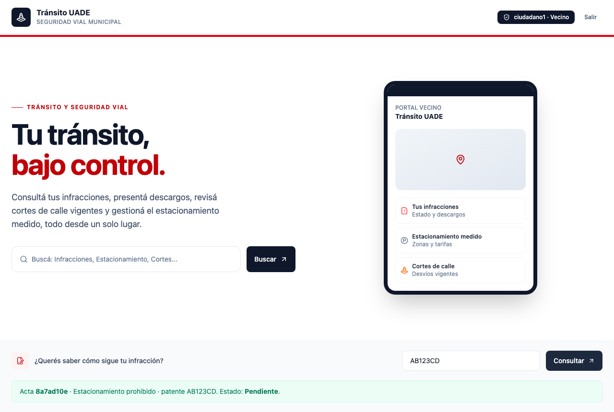

**Resultado esperado:** aparece un recuadro verde con el acta, el tipo, la patente y el **Estado**.

**Errores frecuentes**

- *"No encontramos ninguna infracción tuya con ese número de acta o patente."*: no hay ninguna infracción a tu nombre
  con ese dato. Revisá que esté bien escrito. Solo aparecen las infracciones cargadas con **tu DNI**.
- *"Para consultar un trámite ingresá con tu usuario de vecino."*: entraste con un usuario de personal municipal.

## C3. Ver mis infracciones

1. Tocá la tarjeta **Mis infracciones** (o **Presentar descargo**, que lleva a la misma lista).
2. Vas a ver una tarjeta por infracción con tipo, lugar, fecha, patente, importe y estado.

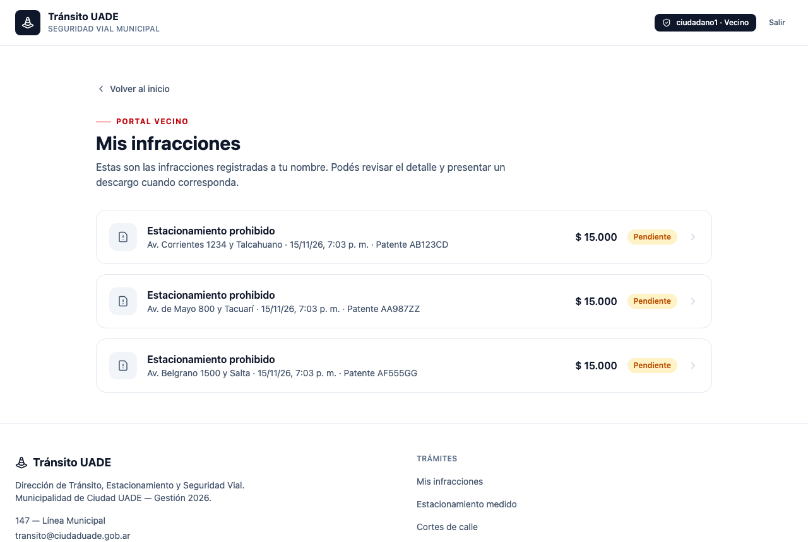

**Resultado esperado:** la lista de infracciones registradas con tu DNI. Si no tenés ninguna, aparece *"No tenés
infracciones registradas. ¡Buen manejo!"*.

**Estados posibles:** **Pendiente** (recién labrada, podés presentar descargo), **Apelada** (presentaste descargo y está
en revisión), **Confirmada** (quedó firme), **Anulada** (se dejó sin efecto).

**Errores frecuentes:** si aparece un mensaje en rojo con **Reintentar**, hubo un problema de conexión: tocá **Reintentar**.

## C4. Ver el detalle de una infracción

1. En **Mis infracciones**, tocá la infracción.
2. Se abre un panel a la derecha con el número de acta, patente, fecha y hora, ubicación, inspector e importe.
3. Para cerrarlo, tocá la **X** de arriba a la derecha.

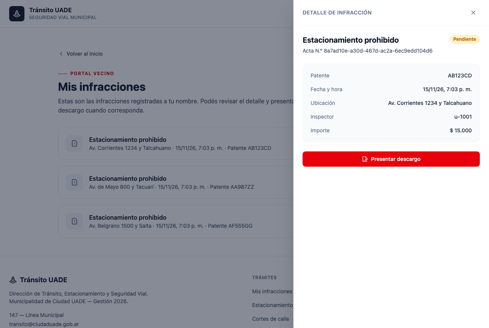

## C5. Presentar un descargo (apelar una infracción)

**Objetivo:** pedir que se revise una infracción que considerás injusta.

1. Abrí el detalle de una infracción en estado **Pendiente** (C4).
2. Tocá **Presentar descargo**.
3. Escribí tus razones en **Motivo del descargo** (obligatorio).
4. Opcional: en **Adjuntar respaldo (opcional)** tocá **Hacé clic para subir archivos** y elegí tus archivos.
5. Tocá **Enviar descargo**.
6. En la confirmación, tocá **Volver a mis infracciones**.

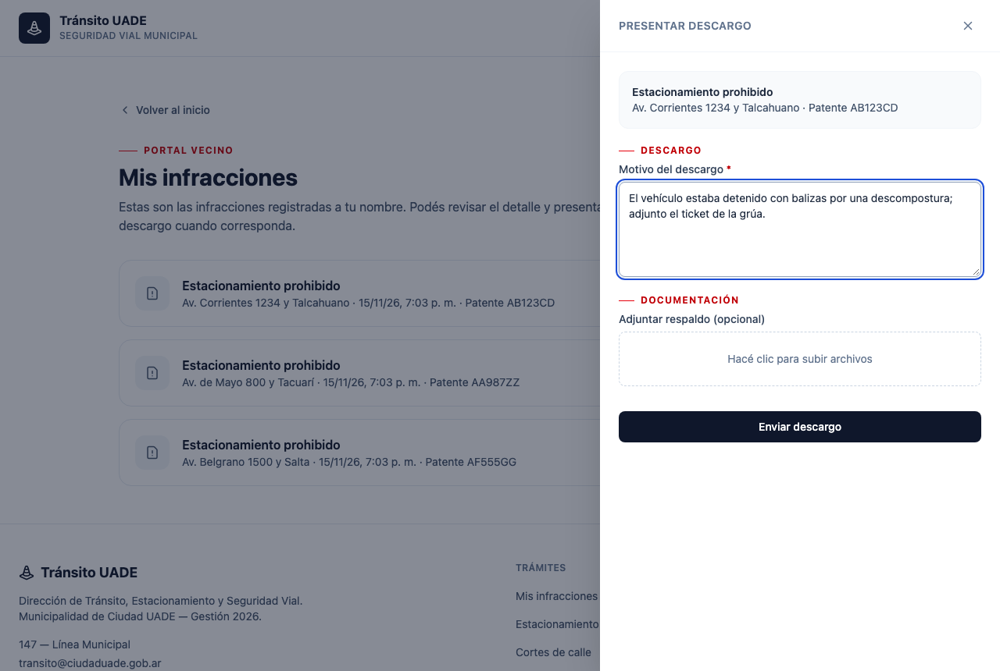

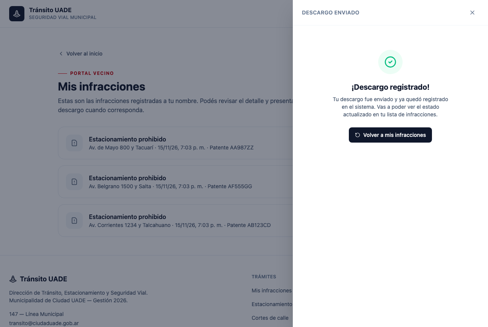

**Resultado esperado:** aparece *"¡Descargo registrado!"* y la infracción pasa a **Apelada**. La tarjeta
**Presentar descargo** del inicio suma uno a "en revisión".

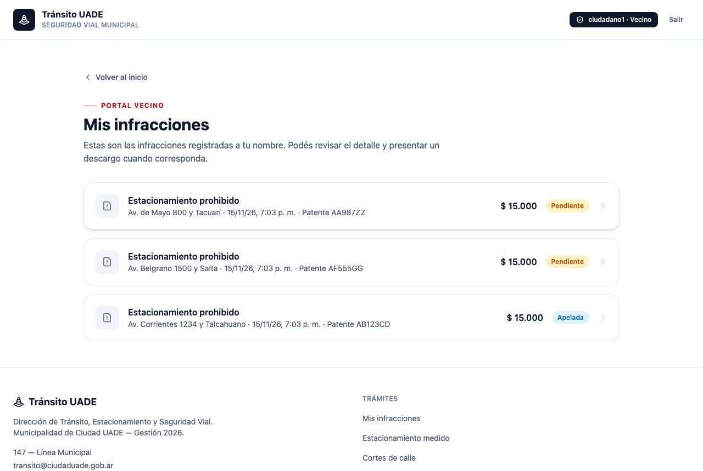

**Errores frecuentes**

- El botón **Presentar descargo** no aparece: la infracción no está **Pendiente** (ya fue apelada, confirmada o anulada).
  Solo se puede presentar un descargo por infracción.
- *"Error al enviar"* con un texto de error 409: la infracción cambió de estado mientras la tenías abierta (por ejemplo,
  ya fue resuelta). Cerrá el panel y volvé a abrir la lista.
- Error 400: falta el motivo o es demasiado largo. Completalo y reintentá.

> **Importante:** por ahora los archivos adjuntos solo se listan en pantalla; **no se envían al sistema**. El texto del
> motivo sí queda registrado. Si tenés documentación, mencionala en el motivo.

## C6. Ver cómo se resolvió mi descargo

1. Entrá a **Mis infracciones** (la lista se actualiza cada vez que entrás).
2. Mirá el estado y abrí el detalle.

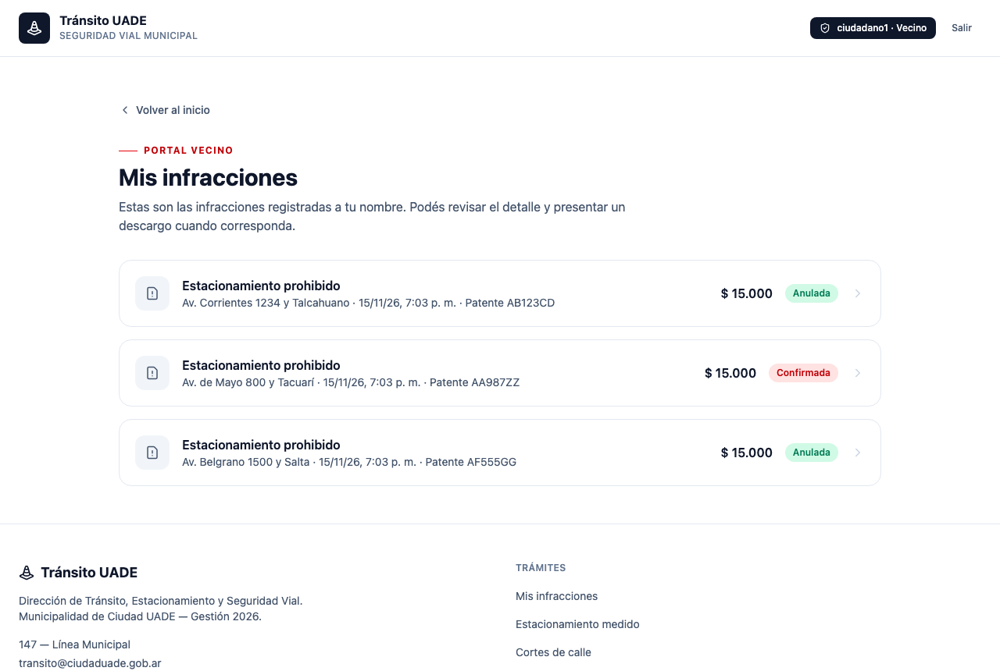

**Resultado esperado**

- **Anulada:** el detalle dice *"Tu descargo fue aceptado. La infracción quedó anulada."*. No tenés que pagar.
- **Confirmada:** el detalle dice *"La infracción quedó firme. Generá tu boleta de pago desde el módulo de Rentas."*.
  El pago no se hace en esta aplicación.

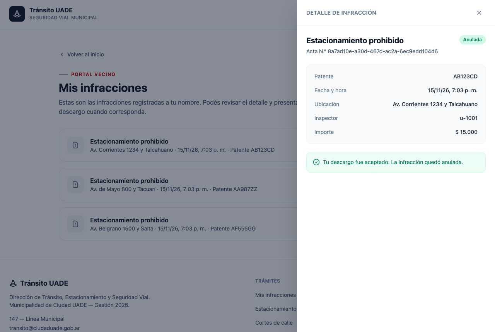

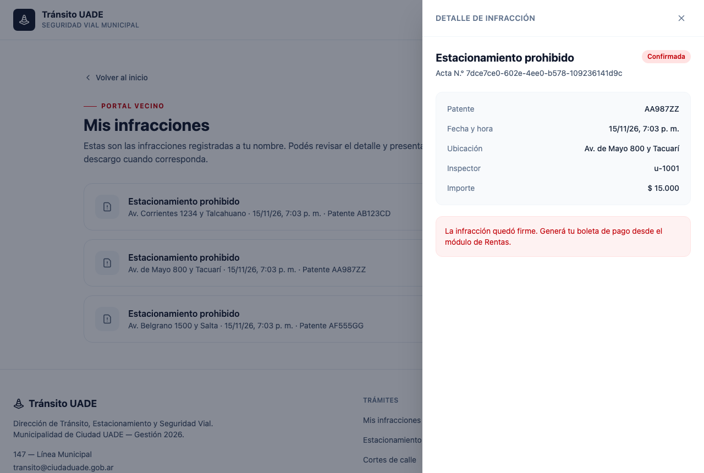

## C7. Consultar zonas y tarifas de estacionamiento medido

1. Tocá la tarjeta **Estacionamiento medido**.
2. Vas a ver cada zona activa con sus límites, horario y precio por hora vigente.

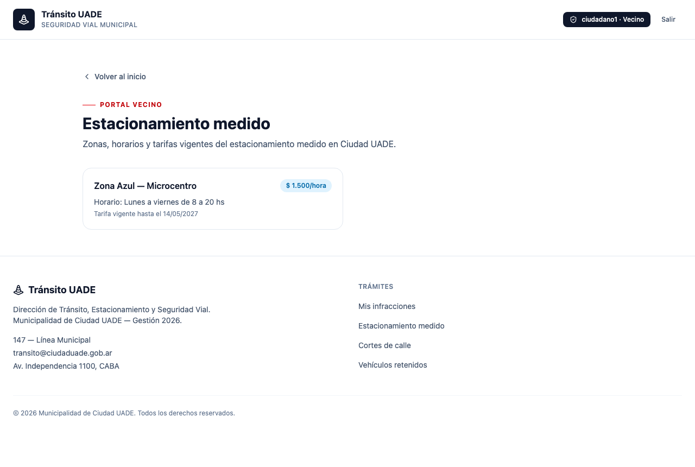

**Resultado esperado:** la lista de zonas activas. Si una zona todavía no tiene precio vigente, figura **Tarifa a
confirmar**. Si no hay zonas, aparece *"No hay zonas de estacionamiento medido activas."*.

> Iniciar o terminar una sesión de estacionamiento **no tiene pantalla** en esta aplicación (ver
> [Funciones disponibles solo vía API](#funciones-disponibles-solo-vía-api)).

## C8. Consultar cortes de calle vigentes

1. Tocá la tarjeta **Cortes de calle**.
2. Cada corte muestra la calle, el horario, quién lo pidió (Obras o Ambiente), el estado y, si los hay, los desvíos.

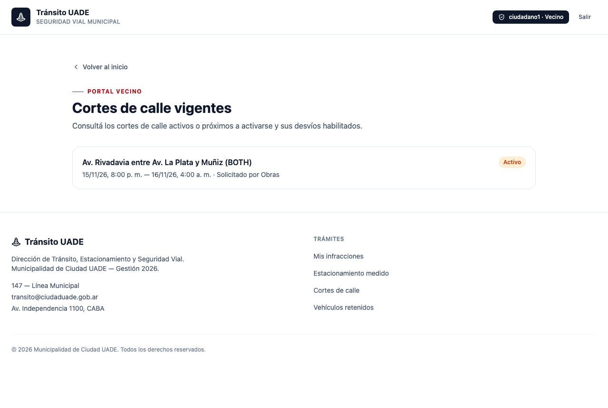

**Resultado esperado:** se listan los cortes **Activo** (ya en curso) y **Próximo** (aprobados, todavía no empezaron).
Si no hay, aparece *"No hay cortes de calle vigentes en este momento."*. Esta consulta funciona para cualquier usuario.

## C9. Consultar mis vehículos retenidos y cómo liberarlos

1. Tocá la tarjeta **Vehículos retenidos**.
2. Cada vehículo muestra patente, estado (**Retenido** o **Liberado**), depósito, fecha de ingreso, motivo y los
   **Requisitos para liberarlo**.
3. Si tenés más de un vehículo, podés escribir la patente en **Filtrar por patente**.

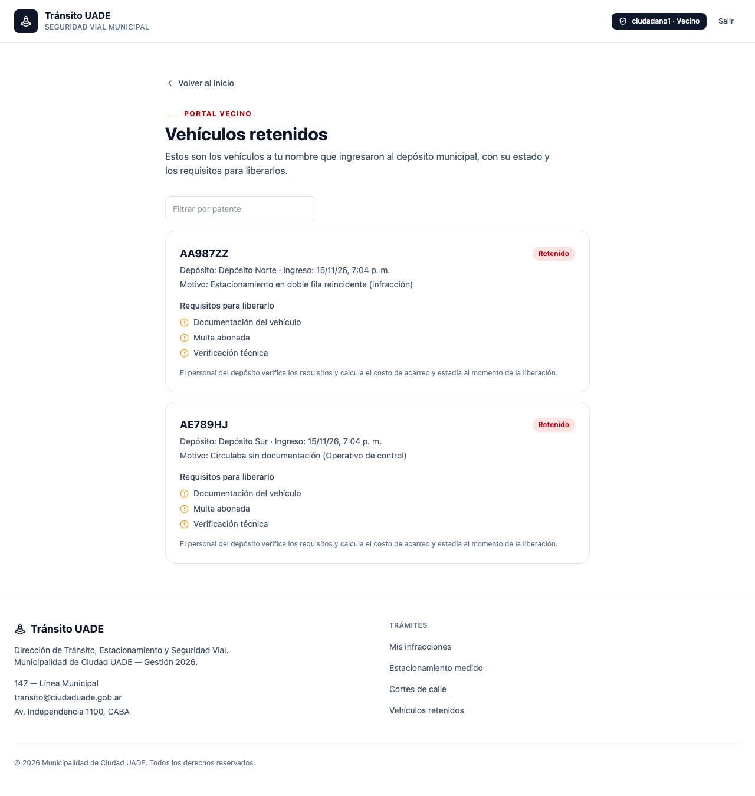

**Resultado esperado:** ves dónde está tu vehículo y qué tenés que presentar. Cuando se libera, el estado cambia a
**Liberado** y se muestran los **Requisitos verificados** y el costo abonado.

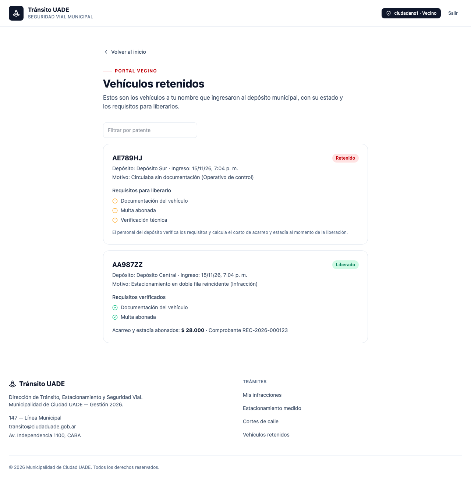

**Errores frecuentes:** *"No tenés vehículos registrados en el depósito municipal."*: no hay vehículos retenidos con tu
DNI como titular. La liberación se hace en forma presencial; el personal del depósito calcula el costo de acarreo y estadía.

## C10. Consultar accidentes en los que figuro y cómo denunciar uno

1. Tocá la tarjeta **Accidentes y denuncias** (o el botón **Consulta general**).
2. Arriba se explica cómo reportar un siniestro (Línea Municipal 147 o el módulo de Atención Ciudadana).
3. Abajo, en **Siniestros en los que figurás**, aparecen los accidentes donde estás como persona involucrada o como
   titular de un vehículo, con su estado (**En revisión** o **Verificado**).

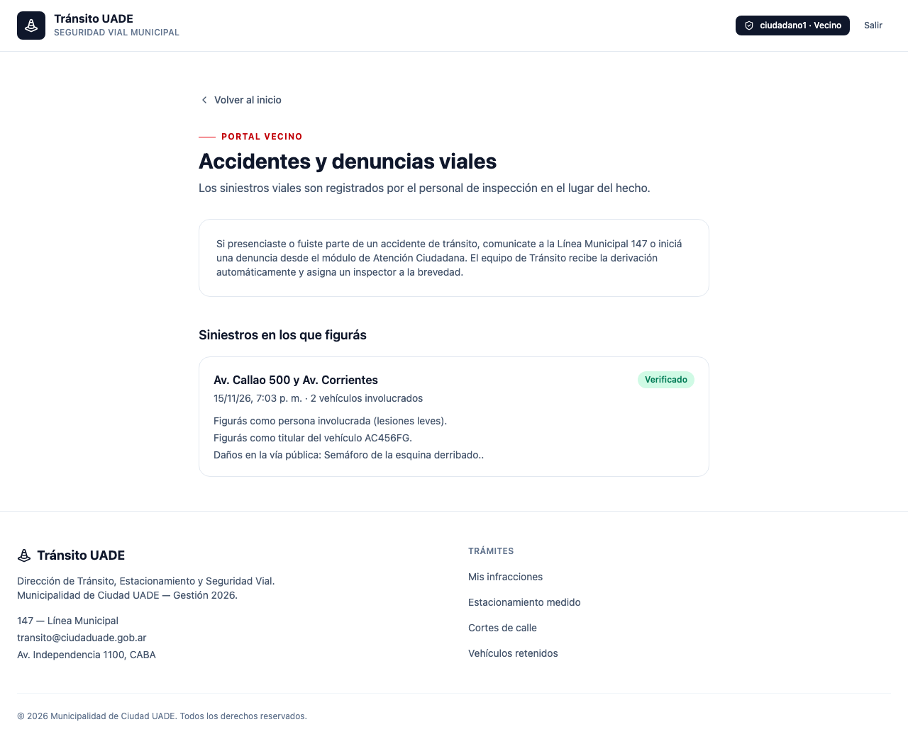

**Resultado esperado:** ves tus siniestros registrados. Si no hay, aparece *"No figurás en ningún siniestro vial registrado."*.
El vecino **no** registra accidentes desde esta aplicación: los carga un inspector.

# Inspector (rol INSPECTOR)

El inspector trabaja en la calle: registra infracciones, operativos, accidentes e ingresos al depósito, activa y
finaliza cortes de calle y marca la falta de pago en el estacionamiento medido.

## I1. Ver el panel de indicadores

1. Al ingresar se abre el **Dashboard** (**Panel de indicadores**). Si estás en otra sección, tocá **Dashboard** en el menú.

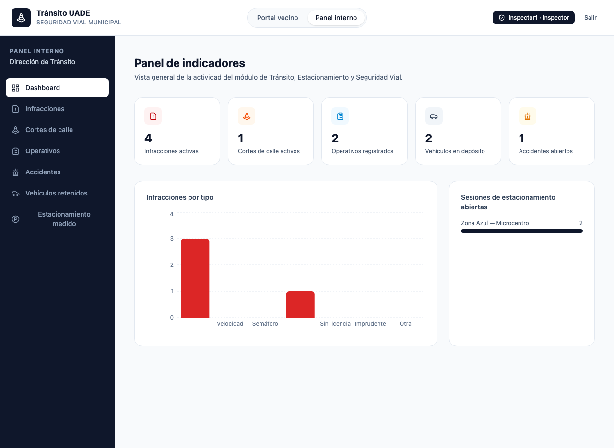

**Resultado esperado:** tarjetas con **Infracciones activas**, **Cortes de calle activos**, **Operativos registrados**,
**Vehículos en depósito** y **Accidentes abiertos**, un gráfico de **Infracciones por tipo** y las **Sesiones de
estacionamiento abiertas** por zona. Los números se actualizan cada vez que entrás al Dashboard.

## I2. Consultar y filtrar infracciones

1. Tocá **Infracciones** en el menú.
2. Usá los filtros de arriba de la tabla: **Todos**, **Pendiente**, **Apelada**, **Confirmada** o **Anulada**.

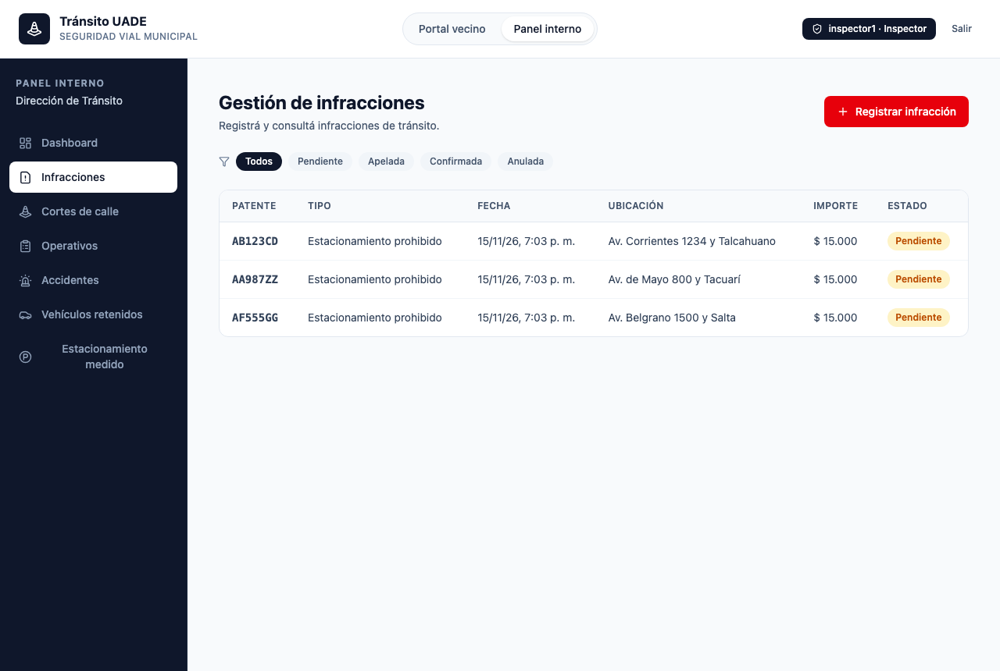

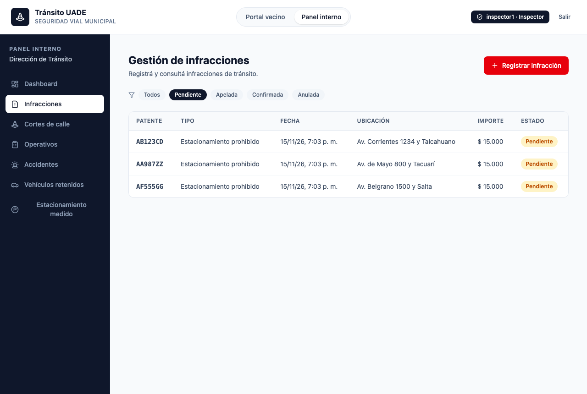

**Resultado esperado:** la tabla muestra patente, tipo, fecha, ubicación, importe y estado de cada infracción.

## I3. Ver el detalle de una infracción

1. En **Infracciones**, tocá cualquier fila de la tabla.
2. Se abre **Detalle de infracción** con todos los datos y los enlaces de evidencia.
3. Cerralo con la **X** o con la tecla Esc.

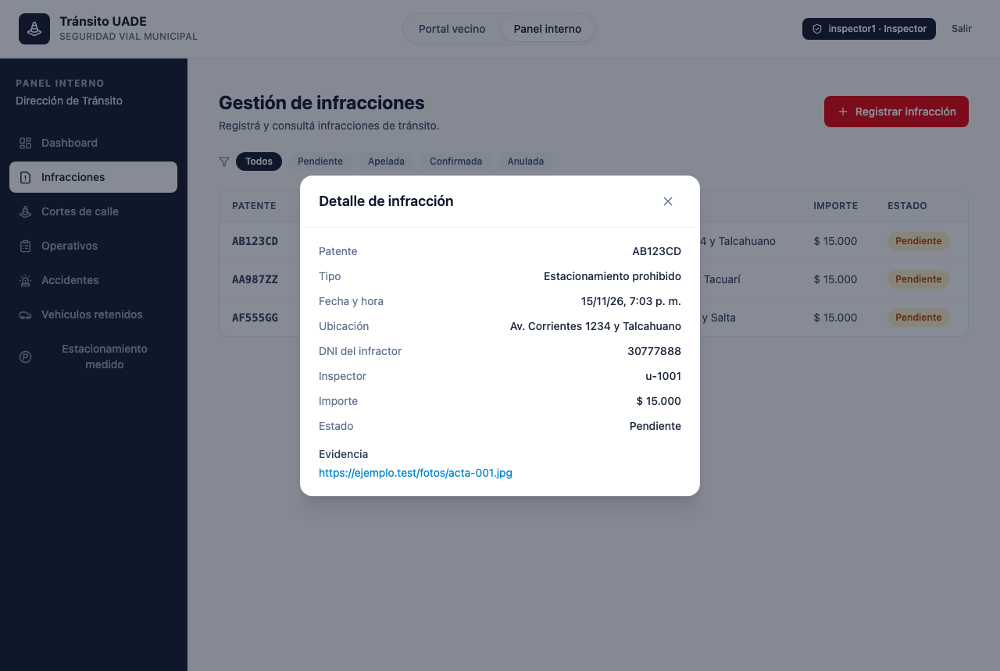

**Para tener en cuenta:** el inspector no confirma ni anula infracciones. Si el vecino presentó un descargo, el detalle
lo indica y aclara *"La resolución la realiza un administrador."*.

## I4. Registrar una infracción (emitir un acta)

**Objetivo:** labrar un acta de infracción.

1. Tocá **Infracciones** en el menú y después **Registrar infracción** (botón rojo, arriba a la derecha).
2. Opcional: usá la ayuda **Sugerir con IA** (tarea I5) para pre-completar el tipo y los agravantes.
3. Elegí el **Tipo de infracción** (obligatorio).
4. Escribí la **Patente** (obligatorio, se pasa a mayúsculas sola; ejemplo AB123CD).
5. Revisá la **Fecha y hora del hecho** (viene con la hora actual; no puede ser futura).
6. Opcional: escribí el **DNI del infractor**. *Con el DNI el vecino ve el acta en su portal.*
7. Escribí la **Calle** (obligatorio) y, si querés, **Entre calle**.
8. Opcional: en **Evidencia** pegá enlaces a fotos o videos, uno por línea.
9. Opcional: marcá los **Agravantes** que correspondan (Reincidencia +50 %, Zona escolar +30 %, Alta velocidad
   registrada +40 %, Resistencia a la autoridad +20 %).
10. Revisá el **Importe calculado** y tocá **Emitir acta de infracción**.

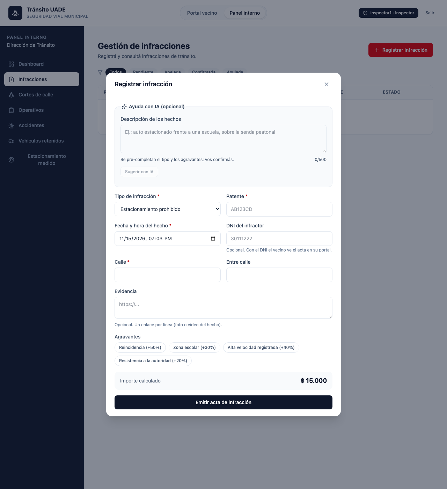

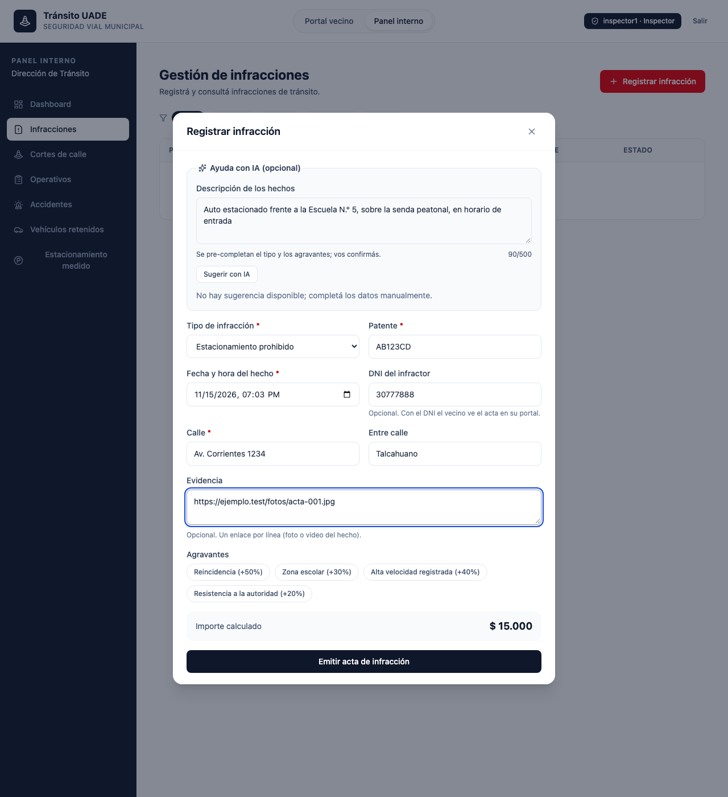

**Resultado esperado:** la ventana se cierra y la infracción aparece en la tabla en estado **Pendiente**. Si cargaste
el DNI, el vecino la ve en **Mis infracciones**.

**Errores frecuentes**

- El botón no hace nada: falta un campo obligatorio (Tipo, Patente, Fecha y hora o Calle).
- *"No se pudo registrar"* con un mensaje de error 400: algún dato no es válido (por ejemplo, fecha futura o un texto
  demasiado largo). El mensaje dice cuál; corregilo y volvé a tocar **Emitir acta de infracción**.
- El botón **Registrar infracción** no aparece: tu usuario no es inspector.

## I5. Usar "Sugerir con IA" al registrar una infracción

**Objetivo:** que la inteligencia artificial proponga el tipo de infracción y los agravantes a partir de una descripción.

> **Aviso importante:** la IA es solo una **sugerencia**. Pre-completa el formulario pero **no guarda nada**. El
> inspector revisa, puede cambiar cualquier dato y es quien confirma el acta con **Emitir acta de infracción**.

1. En el formulario **Registrar infracción**, buscá el recuadro **Ayuda con IA (opcional)**.
2. Escribí lo que viste en **Descripción de los hechos** (hasta 500 caracteres; el contador muestra, por ejemplo, 90/500).
   No hace falta poner datos personales.
3. Tocá **Sugerir con IA** (mientras espera dice "Consultando…").
4. Leé el recuadro **"Sugerido por IA — revisá antes de confirmar"**: el tipo y los agravantes ya quedan marcados en el formulario.
5. Corregí lo que no corresponda y completá el resto de los datos (tarea I4, pasos 4 a 10).

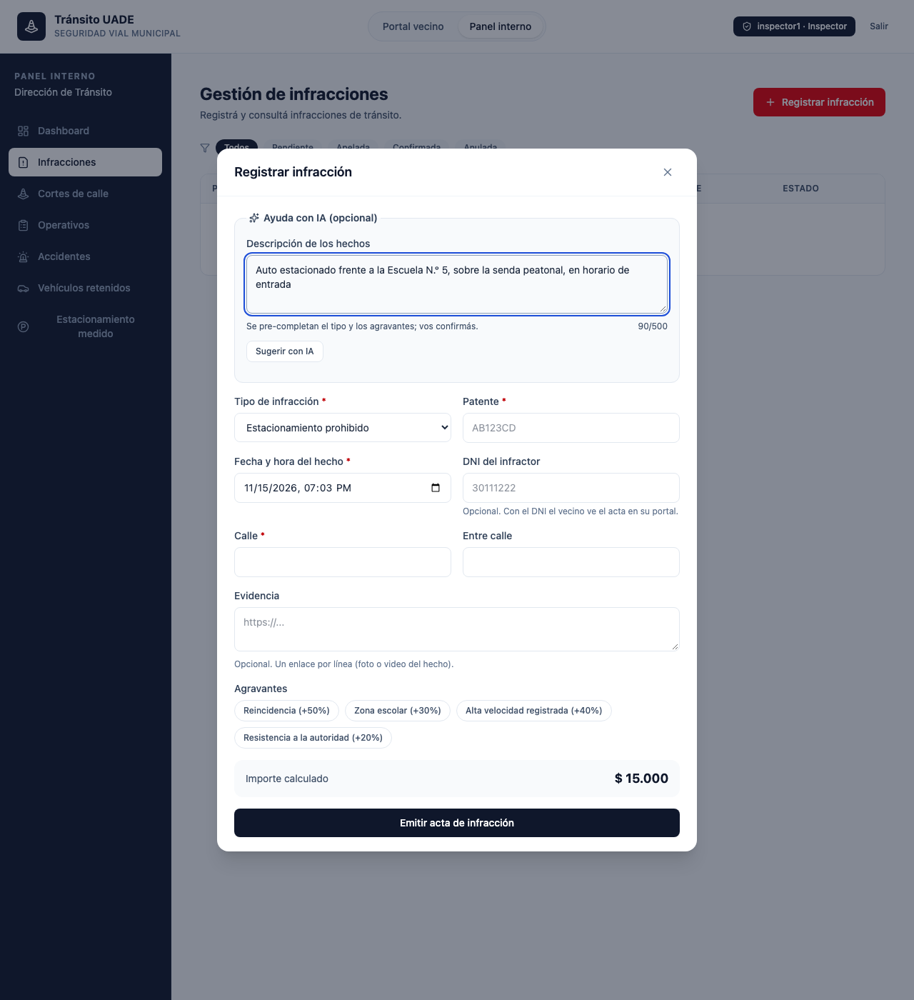

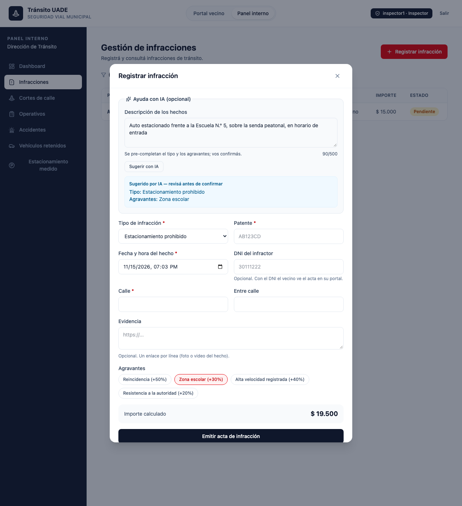

**Resultado esperado:** el **Tipo de infracción** y los **Agravantes** quedan pre-completados y el **Importe calculado**
se actualiza.

**Si la IA no está disponible:** aparece *"No hay sugerencia disponible; completá los datos manualmente."*. No es un
error grave: el servicio de IA no respondió, está apagado o la descripción no alcanzó. Cargá los datos a mano; el
registro funciona igual.

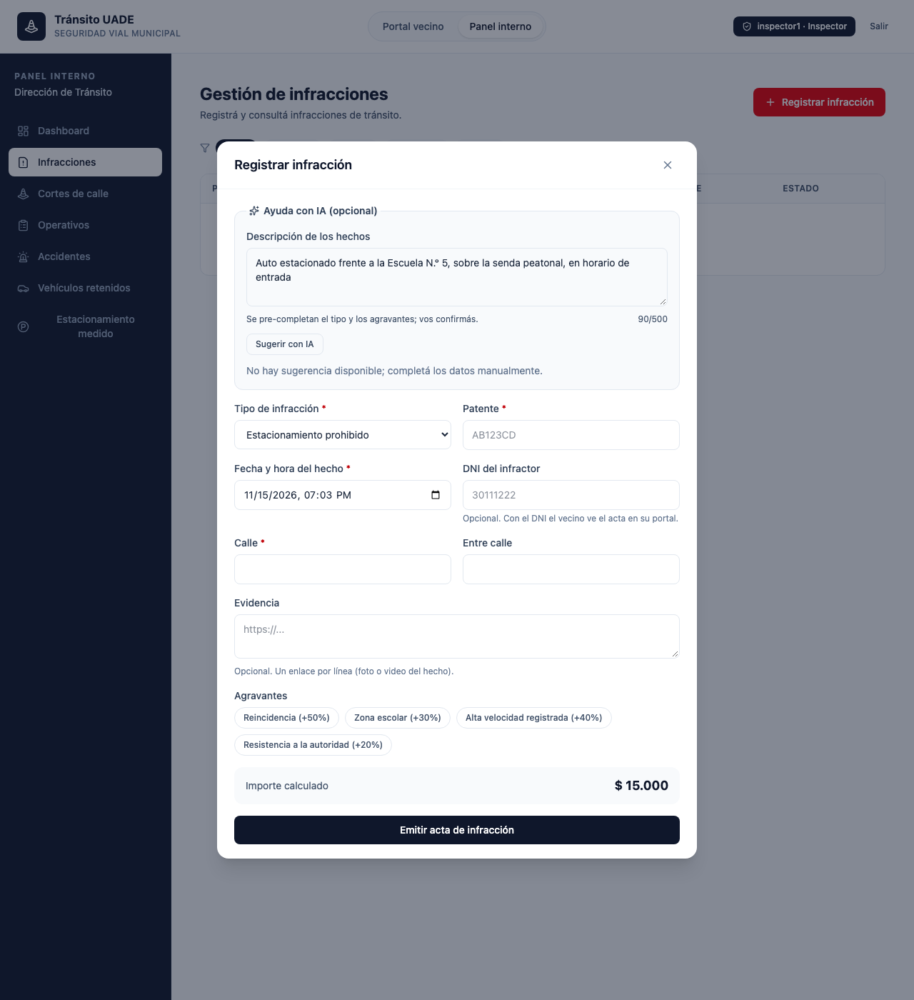

**Errores frecuentes:** *"La descripción no puede superar los 500 caracteres."*: acortá el texto. El botón queda
deshabilitado si la descripción está vacía.

## I6. Crear un operativo de tránsito

1. Tocá **Operativos** en el menú y después **Nuevo operativo**.
2. Elegí el **Tipo de operativo**: Control de rutina, Verificación de denuncia o Inspección de seguridad.
3. Escribí la **Zona** (obligatorio).
4. Opcional: **Móviles asignados**, separados por coma (ejemplo: M-04, M-11).
5. Revisá **Inicio** (obligatorio) y, si querés, cargá **Fin**.
6. En **Inspectores asignados** tocá al menos un nombre (queda resaltado en negro).
7. Tocá **Crear operativo**.

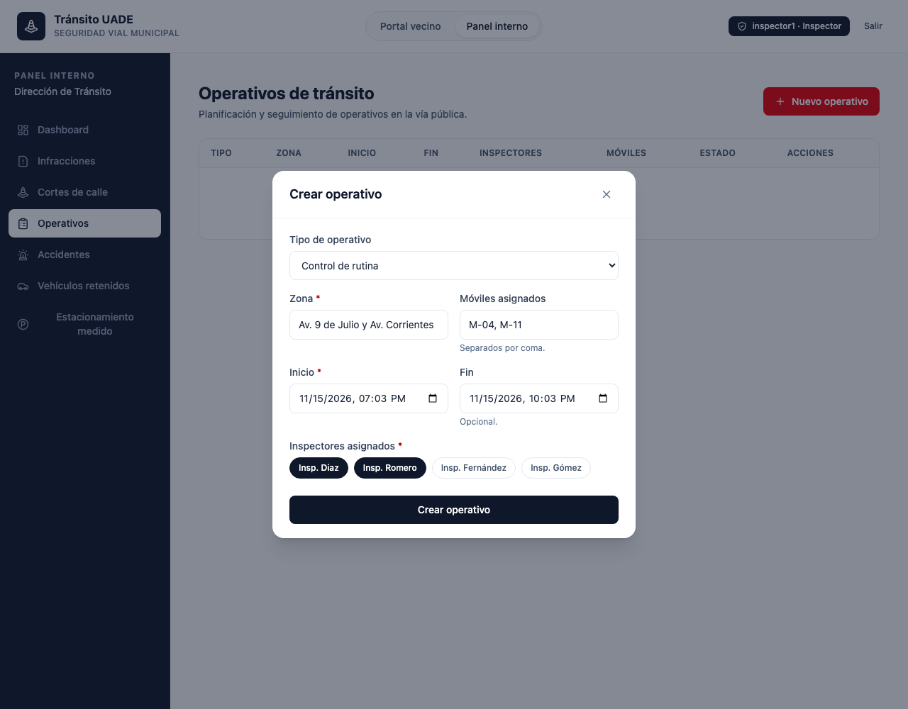

**Resultado esperado:** el operativo aparece en la tabla en estado **Abierto**.

**Errores frecuentes:** si no se crea, revisá que tenga **Zona**, **Inicio** y al menos un inspector. Un error 400 indica
un dato inválido (por ejemplo, **Fin** anterior a **Inicio**).

## I7. Cerrar un operativo

1. En **Operativos**, buscá un operativo **Abierto** y tocá **Cerrar** en la columna **Acciones**.
2. Elegí el **Resultado del operativo**: Se generó una infracción, Se registró un accidente o Sin novedades.
3. Tocá **Cerrar operativo**.

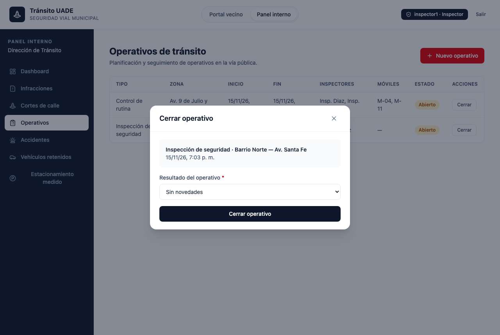

**Resultado esperado:** el estado pasa a **Cerrado** y debajo se ve el resultado elegido.

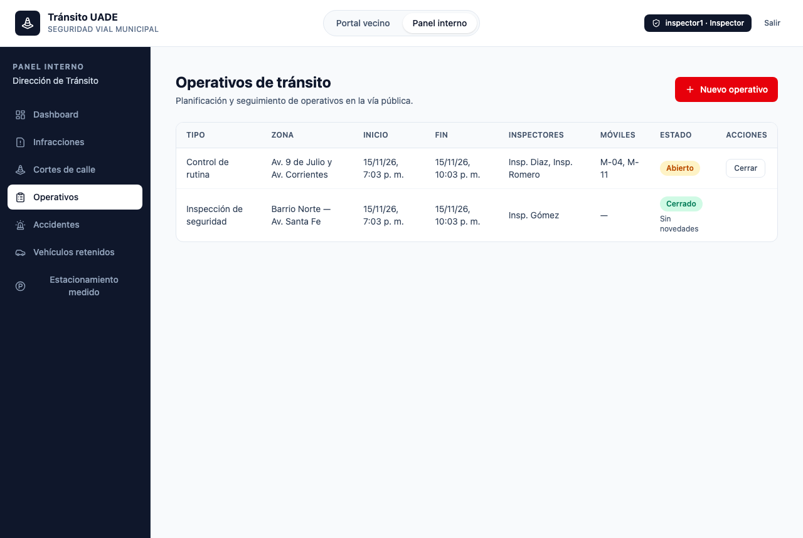

**Errores frecuentes:** error 409: el operativo ya estaba cerrado (por ejemplo, lo cerró otra persona). Recargá la sección.

## I8. Registrar un accidente vial

1. Tocá **Accidentes** en el menú y después **Registrar accidente**.
2. Escribí la **Calle** (obligatorio) y, si querés, **Entre calle**. Revisá **Fecha y hora** (no puede ser futura).
3. Para cada persona involucrada: escribí el **DNI**, elegí la lesión (Sin lesión, Leve o Grave) y tocá **+**.
4. Para cada vehículo: escribí la **Patente** y, si lo sabés, el **DNI titular**, y tocá **+**.
5. Si hubo daños a semáforos, postes u otros bienes públicos, marcá **Involucra daños a infraestructura pública** y
   completá **Descripción de los daños** (obligatoria en ese caso).
6. Tocá **Registrar accidente**.

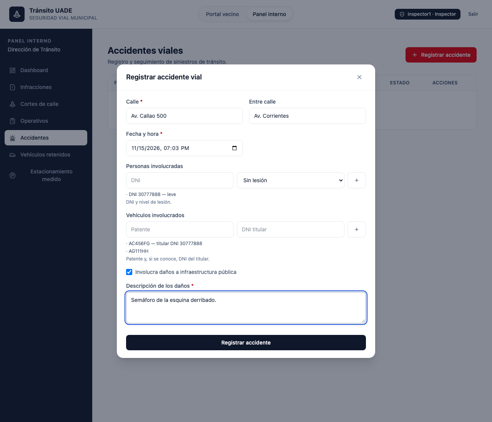

**Resultado esperado:** el accidente aparece en la tabla en estado **En revisión**. Las personas y titulares cargados
con DNI lo ven en su Portal vecino.

**Errores frecuentes:** *"Describí los daños a la infraestructura."*: marcaste daños pero no los describiste. Si te
olvidaste de tocar **+**, igual se incluye lo que quedó escrito en los campos de persona o vehículo.

## I9. Verificar un accidente

1. En **Accidentes**, buscá uno **En revisión** y tocá **Verificar**.

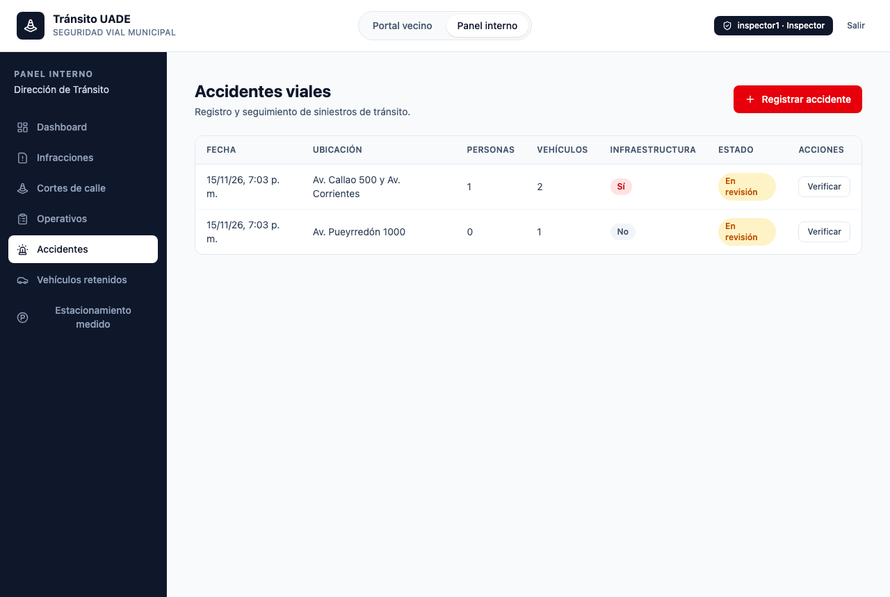

**Resultado esperado:** el estado pasa a **Verificado** y el botón desaparece. Un accidente verificado ya no se modifica.

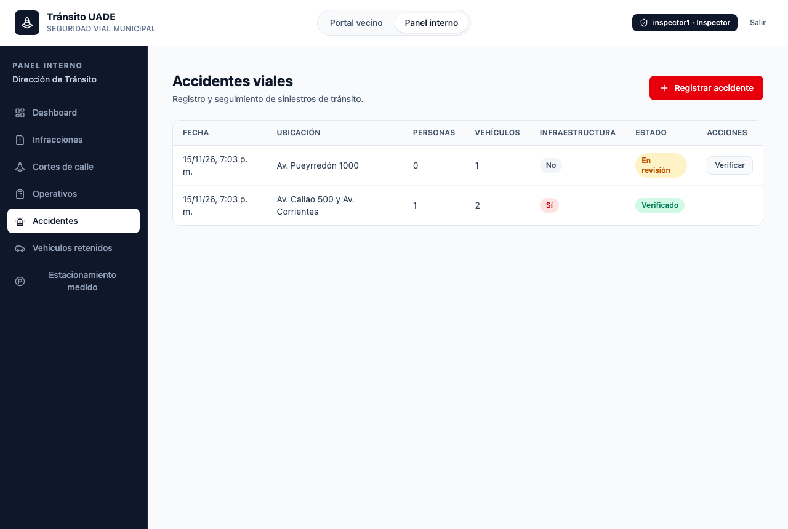

**Errores frecuentes:** error 409: el accidente ya estaba verificado.

## I10. Registrar el ingreso de un vehículo al depósito (acarreo)

1. Tocá **Vehículos retenidos** en el menú y después **Registrar ingreso**.
2. En **Origen de la retención** elegí **Infracción** u **Operativo**.
3. En **Infracción de origen** (u **Operativo de origen**) elegí el registro de la lista. Si es una infracción, la
   patente y el DNI se completan solos.
4. Completá o revisá **Patente** y **DNI del titular** (ambos obligatorios; *con este DNI el vecino ve el vehículo en su portal*).
5. Elegí el **Depósito** (Norte, Sur o Central) y revisá **Fecha y hora de ingreso**.
6. Escribí el **Motivo de la retención** (obligatorio).
7. Tocá **Registrar ingreso**.

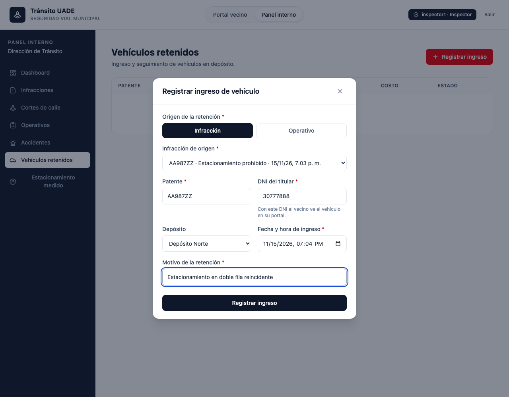

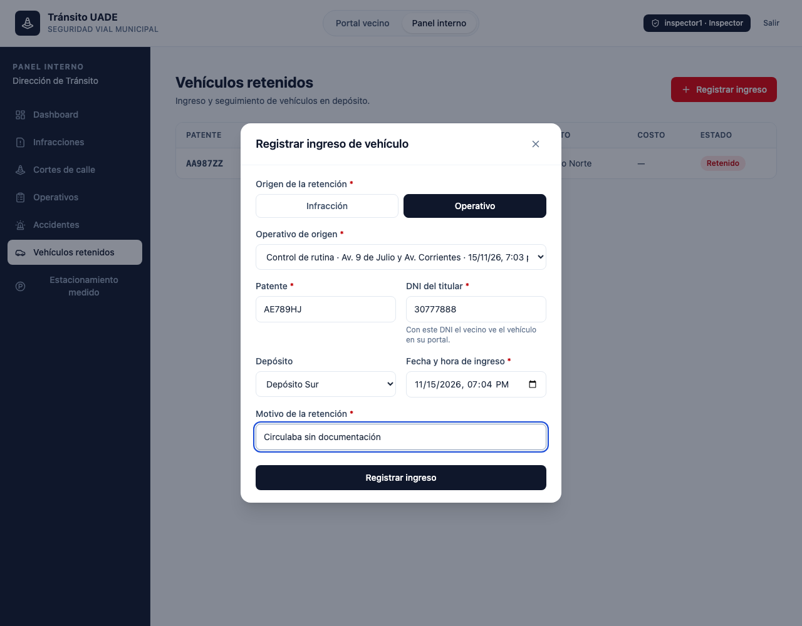

**Resultado esperado:** el vehículo aparece en la tabla como **Retenido**.

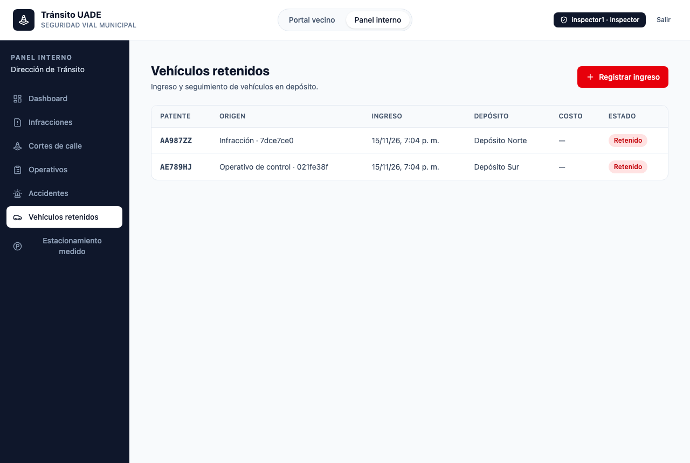

**Errores frecuentes**

- *"No hay registros para vincular todavía."*: primero tiene que existir la infracción o el operativo de origen (I4 o I6).
  Las infracciones anuladas no se ofrecen.
- Error 404: la infracción u operativo elegido ya no existe. Error 400: falta un dato obligatorio o la fecha de ingreso es futura.

## I11. Ver el detalle de un vehículo retenido

1. En **Vehículos retenidos**, tocá la fila del vehículo.

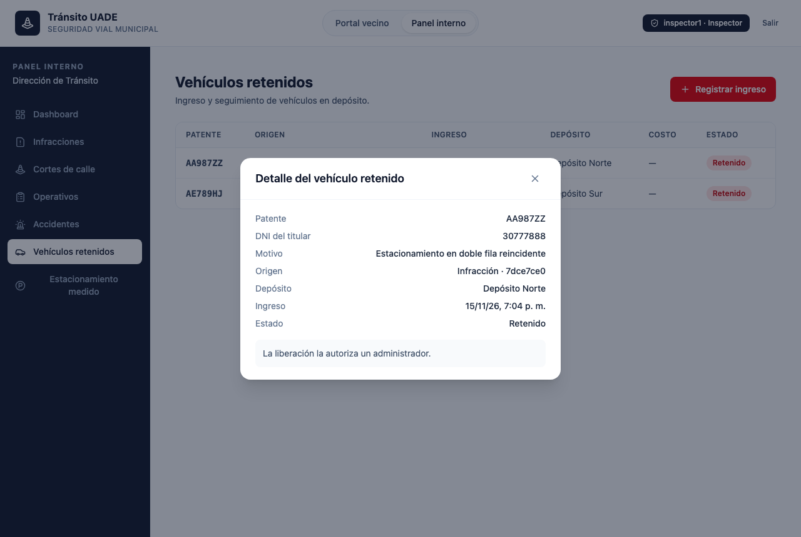

**Resultado esperado:** se ven patente, DNI del titular, motivo, origen, depósito, ingreso y estado. El inspector no
libera vehículos: el detalle dice *"La liberación la autoriza un administrador."*.

## I12. Activar un corte de calle aprobado

Los cortes los piden los módulos de Obras Públicas o Ambiente; el administrador los aprueba (A7) y el inspector los activa
cuando empieza el trabajo en la calle.

1. Tocá **Cortes de calle** en el menú.
2. En un corte **Aprobado**, tocá **Activar**.

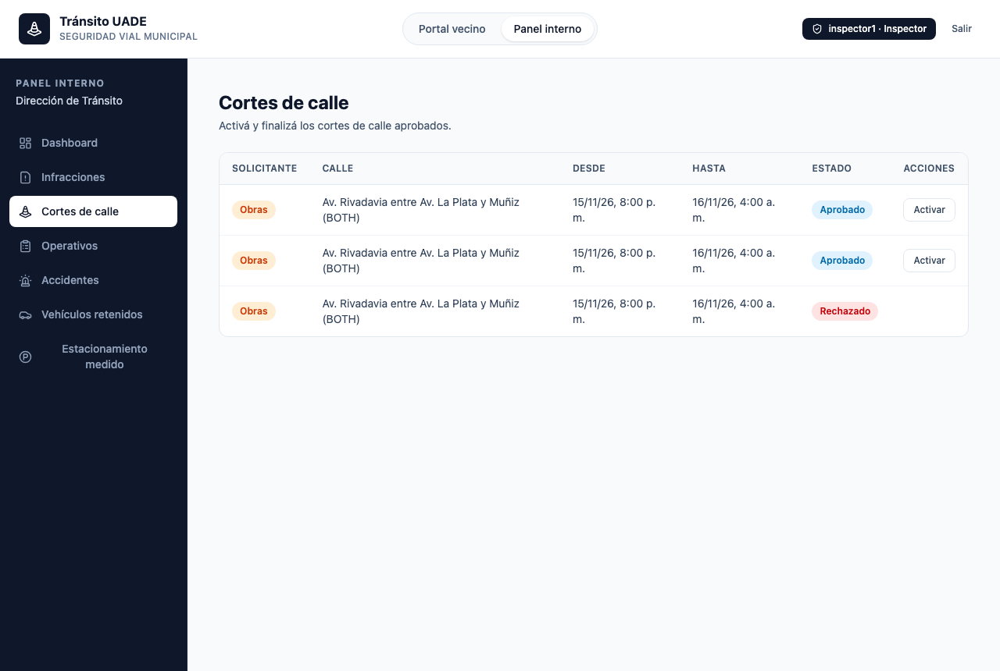

**Resultado esperado:** el estado pasa a **Activo** y aparece el botón **Finalizar**. Los vecinos lo ven como **Activo**.

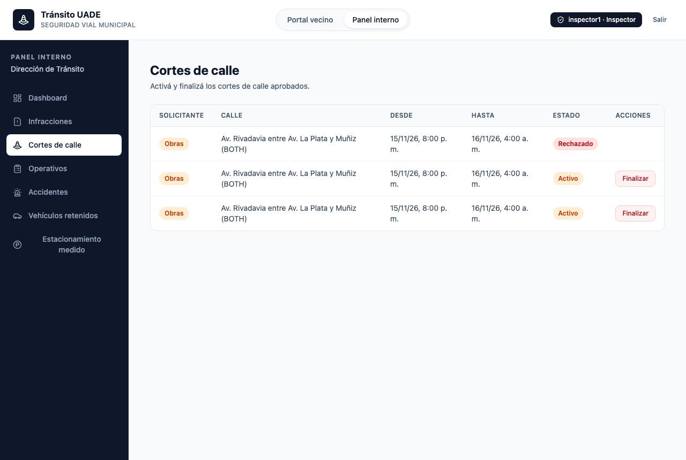

**Errores frecuentes:** error 409: el corte ya no está aprobado (por ejemplo, venció sin activarse y quedó **Vencido**,
o alguien ya lo activó).

## I13. Finalizar un corte de calle

1. En **Cortes de calle**, en un corte **Activo**, tocá **Finalizar**.
2. Escribí las **Observaciones de la finalización** (obligatorio).
3. Tocá **Finalizar corte**.

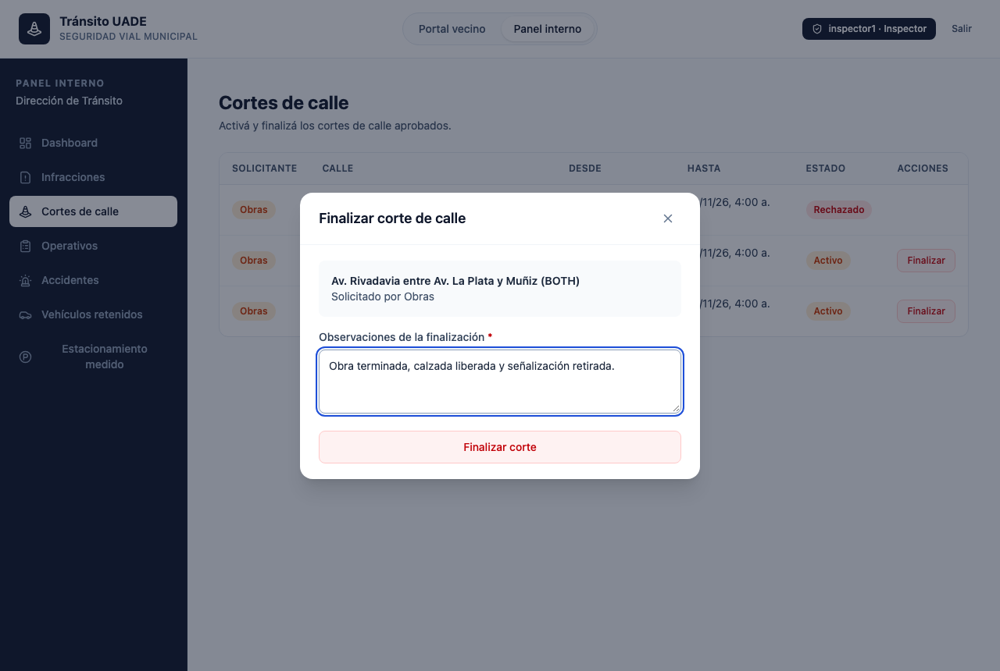

**Resultado esperado:** el estado pasa a **Finalizado** y el corte deja de verse en el Portal vecino.

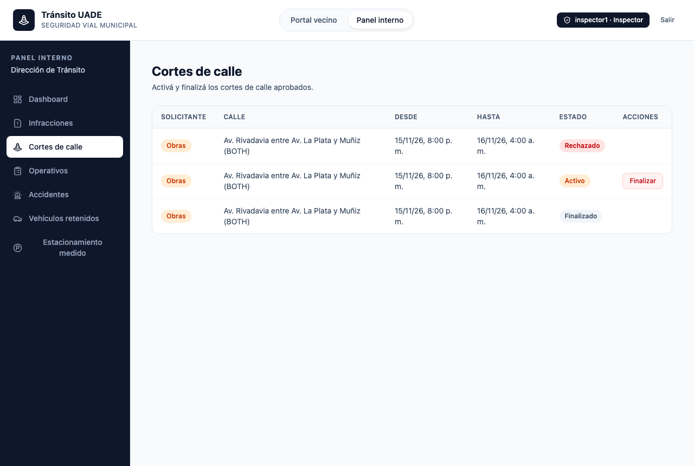

**Para tener en cuenta:** si el corte llega a su **fin autorizado**, el sistema lo cierra solo.

## I14. Consultar zonas y sesiones de estacionamiento medido

1. Tocá **Estacionamiento medido** en el menú.
2. Arriba están las **Zonas configuradas** (con su tarifa vigente) y abajo las **Sesiones de estacionamiento**
   (patente, zona, inicio, fin o "En curso", y si está **Pagada** o **Sin pagar**).

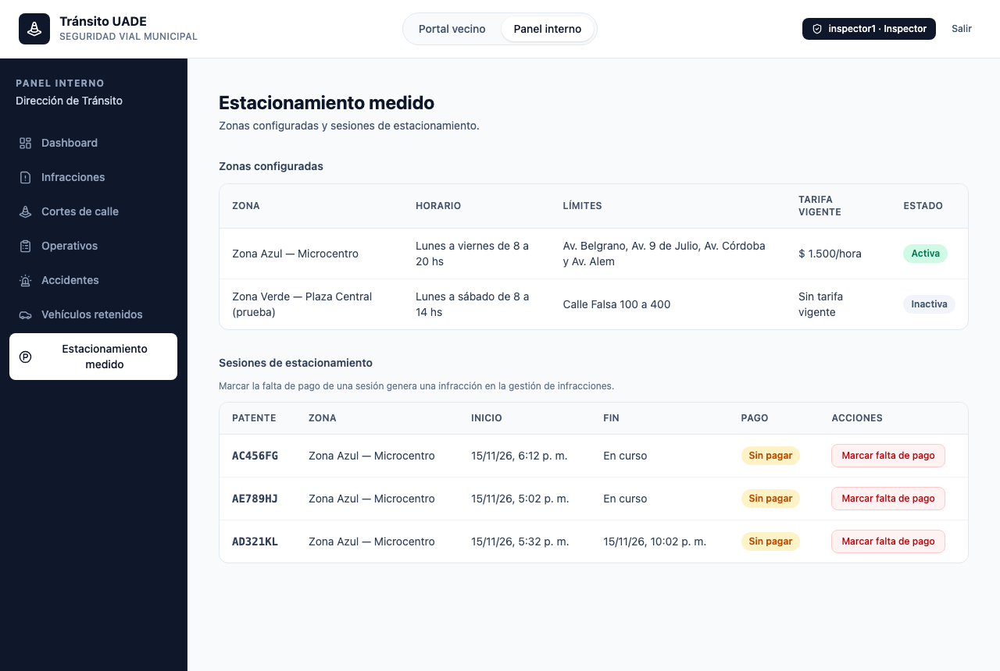

## I15. Marcar la falta de pago de una sesión de estacionamiento

**Objetivo:** generar una infracción por estacionamiento medido sin pago.

1. En **Estacionamiento medido**, en la tabla de sesiones, buscá una **Sin pagar** y tocá **Marcar falta de pago**.
2. Revisá el **Importe base de la infracción** (viene con $ 18.000).
3. Tocá **Generar infracción**.

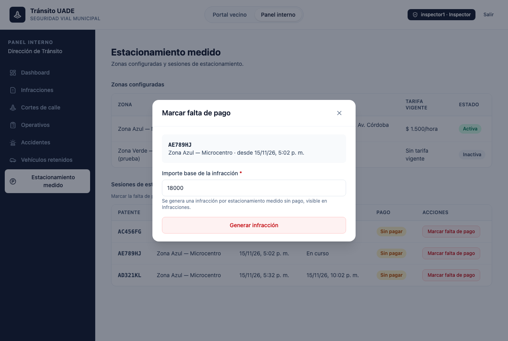

**Resultado esperado:** se crea una infracción "Estacionamiento medido sin pago" en estado **Pendiente**, visible en
**Infracciones**.

**Errores frecuentes:** error 409 *"La sesión … ya tiene una infracción por falta de pago"*: esa sesión ya fue marcada.
La fila puede seguir mostrando el botón; confirmá en **Infracciones** que la infracción existe y no la marques de nuevo.

## I16. Consultar el Portal vecino como personal

1. Tocá **Portal vecino** arriba en el centro (G3).
2. Podés ver las zonas de estacionamiento y los cortes vigentes tal como los ven los vecinos.

**Resultado esperado:** ves la información pública. Las consultas personales del vecino muestran el aviso de que son solo para vecinos.

# Administrador (rol ADMINISTRADOR)

El administrador resuelve: confirma o anula infracciones (incluidos los descargos), evalúa cortes de calle, edita y
libera vehículos retenidos y configura las zonas y tarifas del estacionamiento medido.

## A1. Ver el panel de indicadores

1. Al ingresar se abre el **Dashboard**.

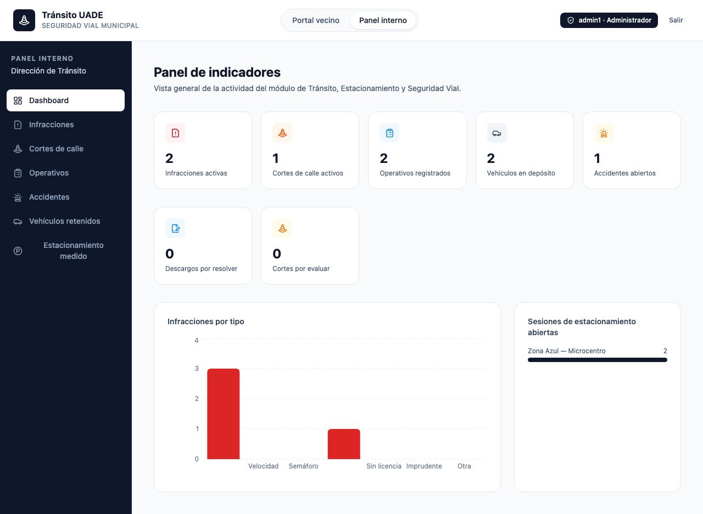

**Resultado esperado:** además de las tarjetas generales, el administrador ve **Descargos por resolver** y **Cortes
por evaluar**: son sus tareas pendientes.

## A2. Consultar y filtrar infracciones

1. Tocá **Infracciones** y usá los filtros **Todos**, **Pendiente**, **Apelada**, **Confirmada** o **Anulada**.
2. Tocá una fila para ver el detalle.

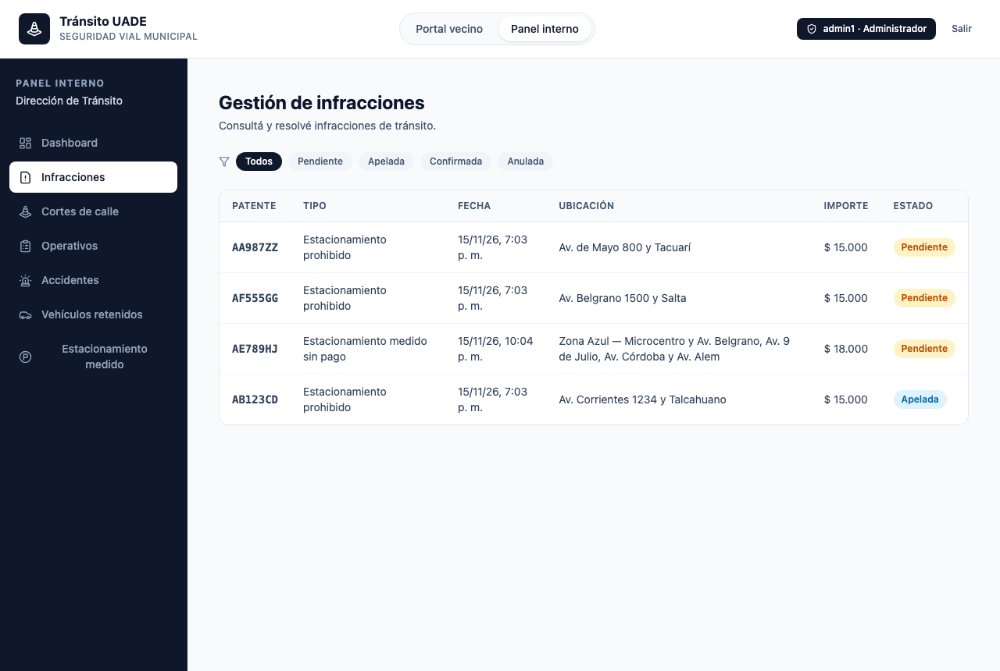

**Para tener en cuenta:** el administrador no registra infracciones (no tiene el botón **Registrar infracción**).

## A3. Aceptar un descargo (anular la infracción)

1. En **Infracciones**, filtrá por **Apelada** y tocá la infracción.
2. Leé el recuadro **El vecino presentó un descargo**.
3. Tocá **Aceptar descargo (anular)**.
4. Escribí el **Motivo de la anulación** (obligatorio, hasta 1000 caracteres).
5. Tocá **Confirmar anulación** (o **Volver** para arrepentirte).

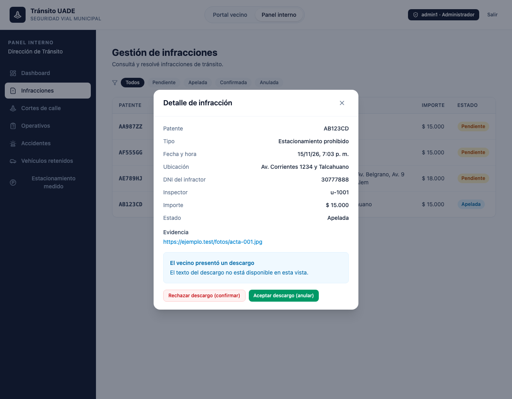

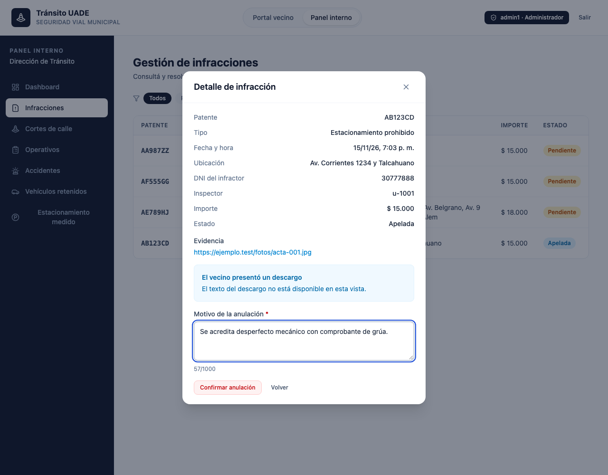

**Resultado esperado:** la infracción pasa a **Anulada** y el vecino ve *"Tu descargo fue aceptado"*.

**Errores frecuentes:** error 409: la infracción ya fue resuelta por otra persona. Cerrá el detalle; la lista se actualiza.

## A4. Rechazar un descargo (confirmar la infracción)

1. Abrí una infracción **Apelada** (como en A3).
2. Tocá **Rechazar descargo (confirmar)**.

**Resultado esperado:** la infracción pasa a **Confirmada** (queda firme) y el vecino ve que debe pagar desde Rentas.
Esta acción se aplica en el momento, sin pedir confirmación: revisá bien antes de tocarla.

## A5. Marcar una infracción pendiente como firme

1. Abrí una infracción **Pendiente**.
2. Tocá **Marcar como firme**.

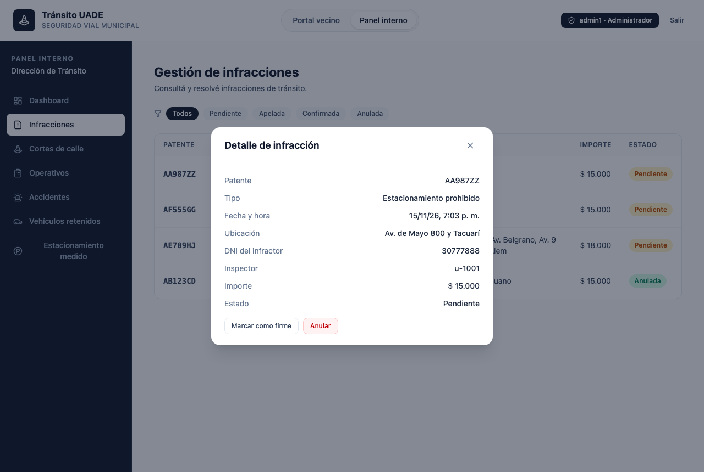

**Resultado esperado:** la infracción pasa a **Confirmada** y el vecino ya no puede presentar descargo.

## A6. Anular una infracción pendiente

1. Abrí una infracción **Pendiente**.
2. Tocá **Anular**.
3. Escribí el **Motivo de la anulación** y tocá **Confirmar anulación**.

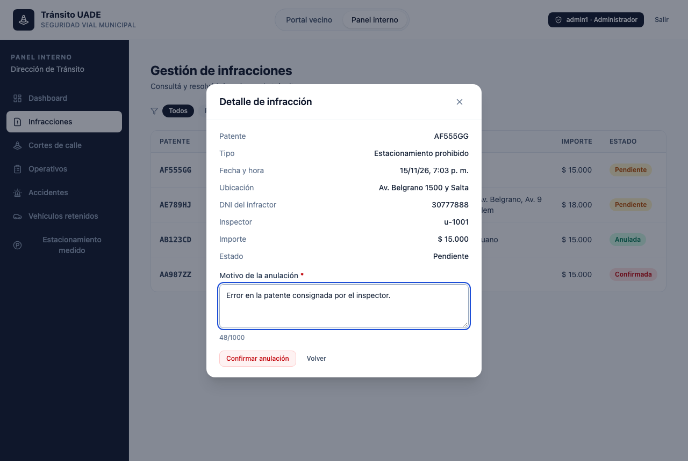

**Resultado esperado:** la infracción pasa a **Anulada**.

**Errores frecuentes (A3 a A6):** las acciones solo aparecen en infracciones **Pendiente** o **Apelada**; una
**Confirmada** o **Anulada** ya no se puede cambiar. **Confirmar anulación** queda deshabilitado si el motivo está vacío.

## A7. Aprobar una solicitud de corte de calle

Las solicitudes llegan solas desde los módulos de Obras Públicas y Ambiente y aparecen como **Pendiente**.

1. Tocá **Cortes de calle** y, en un corte **Pendiente**, tocá **Evaluar**.
2. Dejá elegida la **Decisión** **Aprobar**.
3. Opcional: en **Desvíos** completá **Calle desviada** y **Ruta alternativa**. Para otro desvío, tocá **Agregar desvío**.
4. Opcional: escribí las **Condiciones**, una por línea.
5. Revisá **Inicio autorizado** y **Fin autorizado** (vienen con lo solicitado; cambialos solo si autorizás otro
   horario). *Al vencer el fin autorizado, el corte se cierra automáticamente.*
6. Tocá **Confirmar decisión**.

**Resultado esperado:** el corte pasa a **Aprobado**; el vecino lo ve como **Próximo** y un inspector lo puede activar (I12).

**Errores frecuentes**

- *"Completá la calle y la ruta alternativa de cada desvío."*: un desvío quedó a medio cargar.
- *"El fin autorizado tiene que ser posterior al inicio autorizado."*: corregí las fechas.
- Error 409: la solicitud ya fue evaluada.

## A8. Rechazar una solicitud de corte de calle

1. En un corte **Pendiente**, tocá **Evaluar**.
2. En **Decisión** tocá **Rechazar**.
3. Escribí el **Motivo del rechazo** (obligatorio, hasta 1000 caracteres).
4. Tocá **Confirmar decisión**.

**Resultado esperado:** el corte pasa a **Rechazado** y se le avisa al módulo que lo pidió.

## A9. Consultar vehículos retenidos

1. Tocá **Vehículos retenidos** y después la fila del vehículo.

**Resultado esperado:** se abre **Detalle del vehículo retenido**. Si está **Retenido**, abajo aparecen **Editar datos**
y el formulario de liberación (A10 y A11). El administrador no registra ingresos (eso lo hace el inspector, I10).

## A10. Editar los datos de una retención

1. En el detalle de un vehículo **Retenido**, tocá **Editar datos**.
2. Cambiá **Motivo de la retención**, **Depósito** y/o **DNI del titular** (los tres son obligatorios).
3. Tocá **Guardar cambios** (o **Cancelar**).

**Resultado esperado:** el detalle muestra los datos nuevos. **Guardar cambios** se habilita solo si cambiaste algo.

**Errores frecuentes:** un vehículo **Liberado** ya no se puede editar (error 409).

## A11. Liberar un vehículo retenido

1. En el detalle de un vehículo **Retenido**, marcá los **Requisitos verificados** (al menos uno): Documentación del
   vehículo, Multa abonada, Verificación técnica.
2. Revisá el **Costo de acarreo y estadía**: viene sugerido ($ 25.000 de acarreo + $ 3.000 por día de estadía). Podés cambiarlo.
3. Si el costo es mayor que cero, escribí la **Referencia de pago** (obligatoria en ese caso; ejemplo REC-2026-000123).
4. Tocá **Liberar vehículo**.

**Resultado esperado:** el vehículo pasa a **Liberado**. Al abrirlo de nuevo se ve *"Vehículo liberado"* con los
requisitos, el costo, la referencia de pago y quién autorizó. El vecino lo ve como **Liberado**.

**Errores frecuentes:** el botón **Liberar vehículo** queda gris si no marcaste ningún requisito, si el costo está vacío
o es negativo, o si falta la referencia de pago. Error 409: el vehículo ya estaba liberado.

## A12. Crear una zona de estacionamiento medido

1. Tocá **Estacionamiento medido** y después **Nueva zona**.
2. Completá **Nombre**, **Límites** (calles que la delimitan) y **Horario permitido** (los tres son obligatorios).
3. Tocá **Crear zona**.

**Resultado esperado:** la zona aparece en **Zonas configuradas** como **Activa** y **Sin tarifa vigente** hasta que le
cargues una tarifa (A15).

**Errores frecuentes:** el botón no hace nada si falta alguno de los tres campos. Error 400: algún texto es demasiado largo.

## A13. Editar una zona (y activarla o desactivarla)

1. En **Zonas configuradas**, tocá **Editar** en la fila de la zona.
2. Cambiá los datos. En **Estado** podés elegir **Activa** o **Inactiva** (sirve también para reactivar una zona eliminada).
3. Tocá **Guardar cambios**.

**Resultado esperado:** la tabla muestra los datos nuevos. Las zonas **Inactiva** no se muestran a los vecinos.

## A14. Eliminar una zona

1. En una zona **Activa**, tocá **Eliminar**.
2. Leé el aviso y tocá **Sí, eliminar zona** (o **Cancelar**).

**Resultado esperado:** la zona pasa a **Inactiva** y deja de verse en el Portal vecino. Las sesiones ya registradas se conservan.

## A15. Agregar una tarifa a una zona

1. En la fila de la zona, tocá **Tarifas**.
2. En **Nueva tarifa** completá **Precio por hora**, **Vigente desde** y **Vigente hasta**.
3. Tocá **Agregar tarifa**.
4. Cerrá la ventana con la **X** o la tecla Esc.

**Resultado esperado:** la tarifa aparece en la tabla de la ventana y, si está vigente hoy, en la columna **Tarifa vigente** de la zona.

**Errores frecuentes**

- *"El precio por hora tiene que ser mayor que cero."*
- *"La fecha final no puede ser anterior a la inicial."*
- Error 409: la tarifa está inactiva (fue eliminada) y ya no se puede modificar.

## A16. Editar una tarifa

1. En la ventana **Tarifas — (zona)**, tocá **Editar** en la fila de la tarifa.
2. Cambiá precio o fechas (el título pasa a **Editar tarifa**).
3. Tocá **Guardar tarifa** (o **Cancelar edición**).

**Resultado esperado:** la tabla muestra el valor nuevo.

## A17. Eliminar una tarifa

1. En la ventana **Tarifas — (zona)**, tocá **Eliminar** en la fila de la tarifa.
2. Confirmá con **Sí, eliminar tarifa** (o **Cancelar**).

**Resultado esperado:** la tarifa deja de mostrarse en la zona. No se puede deshacer desde la pantalla.

**Errores frecuentes:** error 409 *"No se puede eliminar la tarifa …: hay sesiones activas dependientes en la zona"*:
hay autos estacionados en esa zona en este momento. Esperá a que terminen las sesiones en curso y volvé a intentar.

## A18. Consultar operativos, accidentes y sesiones de estacionamiento

1. Tocá **Operativos**, **Accidentes** o **Estacionamiento medido** en el menú.

**Resultado esperado:** ves las mismas tablas que el inspector, en modo consulta: el administrador no crea ni cierra
operativos, no registra ni verifica accidentes y no marca faltas de pago. La descripción de la pantalla dice *"(solo lectura)"*.

# Auditor (rol AUDITOR)

El auditor controla: puede ver toda la información del Panel interno, pero no registrar ni modificar nada.

> Las capturas de este rol se tomaron en el entorno de prueba. Los usuarios auditores los crea el equipo del
> Módulo 7 (Usuarios) y se entregan junto con las demás credenciales.

## U1. Ingresar como auditor y ver el panel

1. Ingresá con el perfil **Personal municipal** (G1).
2. Se abre el **Dashboard** con el aviso *"Ingresaste como auditor: podés consultar toda la información del módulo, pero
   no registrar ni modificar datos."*

**Resultado esperado:** ves todos los indicadores, incluidos **Descargos por resolver** y **Cortes por evaluar**.

## U2. Consultar infracciones

1. Tocá **Infracciones**, usá los filtros y tocá una fila para ver el detalle.

**Resultado esperado:** ves la tabla y el detalle completo, sin botones de acción.

## U3. Consultar cortes, operativos, accidentes, vehículos y estacionamiento

1. Tocá la sección que quieras en el menú.

**Resultado esperado:** ves las tablas y los detalles sin los botones **Evaluar**, **Activar**, **Cerrar**,
**Verificar**, **Liberar vehículo**, **Nueva zona**, etc. Si por algún motivo intentás una acción, el sistema responde
*"Esta acción no corresponde a tu rol."* (error 403).

# Qué hace cada rol (resumen)

| Sección | Vecino | Inspector | Administrador | Auditor |
|---|---|---|---|---|
| Infracciones | Ver las propias, presentar descargo | Registrar (con IA opcional), ver | Confirmar, anular, resolver descargos | Ver |
| Cortes de calle | Ver vigentes | Activar, finalizar | Aprobar, rechazar | Ver |
| Operativos | — | Crear, cerrar | Ver | Ver |
| Accidentes | Ver los propios | Registrar, verificar | Ver | Ver |
| Vehículos retenidos | Ver los propios | Registrar ingreso, ver | Editar, liberar | Ver |
| Estacionamiento medido | Ver zonas y tarifas | Ver, marcar falta de pago | Zonas y tarifas (crear, editar, eliminar) | Ver |
| Dashboard | — | Sí | Sí (+ pendientes) | Sí (+ pendientes) |

# Mensajes de error y qué significan

| Código | Mensaje típico en pantalla | Qué significa | Qué hacer |
|---|---|---|---|
| 400 | Texto que indica el campo con problema (por ejemplo, "La patente es obligatoria") | Faltan datos o algún dato no es válido. | Corregí el campo indicado y volvé a intentar. |
| 401 | "Usuario o contraseña incorrectos." / "Tu sesión venció. Volvé a ingresar." | No estás identificado: clave incorrecta o sesión vencida. | Revisá tus datos o ingresá de nuevo. |
| 403 | "Esta acción no corresponde a tu rol." | Tu usuario no tiene permiso para esa acción. | Pedile la tarea a quien tenga el rol correcto (ver tabla de roles). |
| 404 | "No encontrado" o similar | El registro no existe (por ejemplo, fue reemplazado o el enlace es viejo). | Volvé a la lista; se recarga con los datos actuales. |
| 409 | Texto que explica el conflicto (por ejemplo, "ya tiene una infracción por falta de pago") | La acción choca con el estado actual: alguien ya la hizo o el registro cambió de estado. | Cerrá la ventana, mirá el estado actualizado y decidí de nuevo. |
| 429 | "Demasiados intentos de inicio de sesión. Reintentá en N segundos." | Muchos intentos de ingreso fallidos seguidos. Es una protección. | Esperá el tiempo indicado. |
| — | "No se pudo conectar con el servidor. Intentá nuevamente." | Sin internet o el servidor no responde. | Revisá la conexión y reintentá en unos minutos. |

# Funciones disponibles solo vía API

El sistema (backend) tiene algunas funciones que **todavía no tienen pantalla** en la aplicación web. Se usan desde la
API (documentada en Swagger) o desde otros módulos:

| Función | Quién | Detalle |
|---|---|---|
| Iniciar y cerrar una sesión de estacionamiento medido | Vecino, Inspector | `POST /parking-sessions` y `POST /parking-sessions/{id}/closure`. En la web solo se ven las sesiones (I14). |
| Editar los datos de una infracción ya registrada | Inspector | `PATCH /infractions/{id}`. En la web no hay botón **Editar** para infracciones. |
| Editar un operativo abierto | Inspector | `PATCH /operations/{id}`. En la web solo se crea y se cierra. |
| Editar los datos de un accidente | Inspector | `PATCH /accidents/{id}`. En la web solo se usa para **Verificar**. |
| Crear solicitudes de corte de calle | Módulos Obras y Ambiente | Llegan automáticamente por mensajería (Core). En la web solo se evalúan. |
| Consultar la bandeja de eventos enviados a Core | Administrador, Auditor | `GET /admin/outbox`. Uso técnico. |
| Ver el texto de un descargo desde el panel | — | El detalle del panel muestra *"El texto del descargo no está disponible en esta vista."* |

# Glosario

- **Acta / infracción:** registro de una falta de tránsito labrado por un inspector.
- **Agravante:** circunstancia que aumenta el importe (por ejemplo, zona escolar +30 %).
- **Descargo / apelación:** pedido del vecino para que se revise una infracción **Pendiente**.
- **Pendiente:** infracción recién labrada, admite descargo.
- **Apelada:** el vecino presentó descargo; espera la decisión del administrador.
- **Confirmada (firme):** la infracción queda vigente y debe pagarse en Rentas.
- **Anulada:** la infracción queda sin efecto.
- **Corte de calle:** cierre total o parcial de una calle pedido por Obras o Ambiente. Estados: Pendiente, Aprobado
  (para el vecino, "Próximo"), Rechazado, Activo, Finalizado y Vencido (aprobado que nunca se activó).
- **Desvío:** calle cortada y ruta alternativa sugerida.
- **Operativo:** control planificado en la vía pública con inspectores y móviles asignados. Estados: Abierto y Cerrado.
- **Accidente / siniestro vial:** choque o incidente registrado por un inspector. Estados: En revisión y Verificado.
- **Retención / acarreo:** traslado de un vehículo al depósito municipal por una infracción o un operativo.
- **Liberación:** devolución del vehículo, con requisitos verificados y pago de acarreo y estadía.
- **Estacionamiento medido:** estacionamiento pago por hora en zonas definidas. **Sesión**: cada estacionamiento de una patente en una zona.
- **Falta de pago:** sesión sin pagar que el inspector convierte en infracción.
- **Sugerir con IA:** ayuda opcional que propone tipo y agravantes a partir de una descripción. **El inspector siempre confirma.**
- **Dashboard / Panel de indicadores:** resumen con números y gráficos de la actividad del módulo.

# Preguntas frecuentes

**¿Dónde consigo mi usuario y contraseña?**
Los entrega el equipo del Módulo 7. No se publican en este manual.

**No veo un botón que dice este manual.**
Los botones dependen del rol y del estado del registro. Por ejemplo, **Presentar descargo** solo aparece en infracciones
**Pendiente**, y **Activar** solo en cortes **Aprobado** y para inspectores. Revisá la tabla de roles.

**¿La IA decide la infracción?**
No. La IA solo **sugiere** el tipo y los agravantes. El inspector revisa, corrige si hace falta y confirma con
**Emitir acta de infracción**. Si la IA no responde, se carga todo a mano.

**Soy vecino y no veo una infracción que me hicieron.**
Solo se ven las infracciones cargadas con tu DNI. Si el inspector no cargó el DNI, no va a aparecer en tu portal.

**¿Puedo pagar la multa desde acá?**
No. Cuando la infracción queda **Confirmada**, la boleta se genera en el módulo de Rentas.

**¿Se envían los archivos que adjunto en el descargo?**
Todavía no: se listan en pantalla pero solo se registra el texto del motivo.

**¿Por qué una zona dice "Sin tarifa vigente" o "Tarifa a confirmar"?**
No tiene una tarifa cuyas fechas incluyan el día de hoy. El administrador debe cargarla (A15).

**Marqué una falta de pago y la sesión sigue diciendo "Sin pagar".**
Es normal: la infracción se crea igual en **Infracciones**. No la marques de nuevo (daría error 409).

**¿Qué pasa si dos personas resuelven lo mismo a la vez?**
La primera acción se guarda; la segunda recibe un error 409. Cerrá la ventana y mirá el estado actualizado.

**¿La aplicación funciona en el celular?**
Sí. En pantallas chicas el menú del Panel interno se muestra como una lista desplegable arriba.
